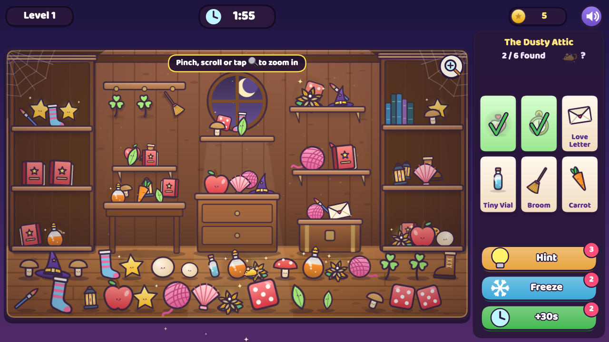
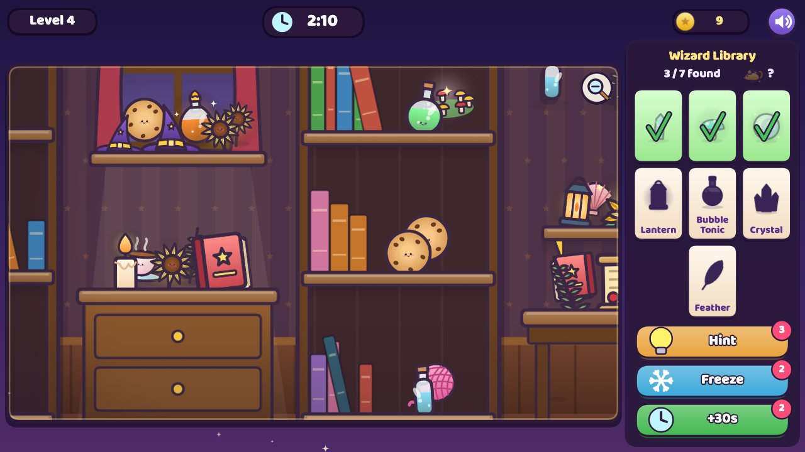

# Magic Attic: Hidden Objects

A cozy hidden-object game for the browser. Search a witch's cluttered house for the items on your list before the clock runs out, and spot the golden mouse hiding in every room.

Plain JavaScript and one `<canvas>`. No engine, no build step, no dependencies. Every object, room and icon is drawn with canvas code, so the whole game is about 3,000 lines in `src/` and has no image files.

**Play it:** https://beastx889.github.io/magic-attic/



## Features

- 6 hand-built room themes: Dusty Attic, Cozy Kitchen, Moonlit Garden, Wizard Library, Potion Lab, Sleepy Bedroom
- 64 findable objects (keys, teacups, potions, crystals, rubber ducks...) plus a golden mouse in every room
- Endless levels: rooms come back in new layouts, with more items, smaller sizes and tighter clutter
- Three list styles: pictures, shadows (find items by outline) and words (find items by name)
- Pinch, mouse wheel or magnifier button to zoom, drag to look around
- Combo streaks, stars for fast finishes, coins, and three boosters (Hint, Freeze, +30 s)
- Landscape layout with a side panel, portrait layout with a bottom tray; works with mouse and touch
- Sound effects and music made with the Web Audio API
- Progress saved in `localStorage`



## Run it locally

The game uses ES modules, so open it through a local web server rather than `file://`:

```sh
git clone https://github.com/BeastX889/magic-attic.git
cd magic-attic
python3 -m http.server 8000
# open http://localhost:8000
```

Handy URL options: `?level=7` jumps to a level, `?reset` clears the saved progress.

All asset paths are relative, so the folder works as is from any sub-path (GitHub Pages, itch.io, your own site).

## Project layout

| File | What it does |
|---|---|
| `index.html` | Page shell, loads `src/main.js` |
| `src/main.js` | Rendering, camera and zoom, input, HUD, popups |
| `src/game.js` | Rules and state (timer, finds, combos, coins, boosters, save data). Emits events, never draws |
| `src/data.js` | `CATALOG` of findable kinds, `THEMES` (room order), level difficulty, scene generator |
| `src/objects.js` | The everyday objects, one drawing function each, plus `OBJECT_NAMES` |
| `src/art.js` | Drawing helpers and the potion / herb / mushroom / crystal item sets |
| `src/rooms.js` | Room furniture, walls and foreground decoration per theme |
| `src/fx.js` | Particles, floating text, easing, screen shake |
| `src/audio.js` | Synthesized sound effects and music |
| `src/portal.js` | Optional web-portal adapter (see below) |
| `tools/` | Screenshot, key-art and gallery pages, a zip builder and a headless smoke test |

## Adding objects

1. In `src/objects.js`, add a drawing function to the `D` table. It gets the 2D context `g`, the sprite size `s` and an outline width `w`, and draws inside an `s` x `s` box. The helpers `fi()` (fill + outline), `st()` (stroke), `circle`, `rrect`, `lg`/`rg` (gradients) and `shine` keep it in the house style.
   ```js
   teapot(g, s, w) {
     circle(g, s * 0.5, s * 0.55, s * 0.3); fi(g, '#8ad0ff', w);
     // spout, lid, handle...
   },
   ```
2. Give it a display name in `OBJECT_NAMES` (`teapot: 'Teapot'`).
3. That is all. `CATALOG` in `src/data.js` is built from `OBJECT_NAMES`, so the new object is findable on the next load. Open `tools/gallery.html` (through the local server) to see every object side by side.

The magic items (potions, herbs, mushrooms, crystals) come from the `MAGIC` name lists in `src/data.js` and are drawn by `itemSprite()` in `src/art.js`.

## Adding a room

1. In `src/rooms.js`, add a theme to the `T` table: its column pieces (`bookcase`, `pegs`, `window`, `wallshelf`, `stove`, `bench`, `stump`, `cauldron`, `bed`), wood/cloth/metal colours, a light tint and a foreground decoration (`cobweb`, `lights`, `grass`, `vines`).
2. Add a wall painter for it in `WALLS` (or reuse one), and new furniture in `BACK` / `FRONT` if you want pieces of your own.
3. Add `{ id: 'yourtheme', name: 'Your Room' }` to `THEMES` in `src/data.js`. Levels walk through `THEMES` in order.

Difficulty per level (item count, size, overlap, list style, time) is set in `levelParams()` in `src/data.js`.

## Web portals (optional)

`src/portal.js` wraps the SDKs of several web game portals (CrazyGames, Poki, GameDistribution, Playgama, GameMonetize) behind one small API: `init`, `loadingDone`, `gameplayStart/Stop`, `midgame`, `rewarded`, `store`, `muted`. The default is `none`: no SDK is loaded, no ads are shown and booster rewards are simply granted for free.

Pick a portal with `?portal=poki` in the URL, or bake one into a zip:

```sh
python3 tools/build.py          # dist/magic-attic-standalone.zip (no ads)
python3 tools/build.py poki     # dist/magic-attic-poki.zip
```

## Smoke test

```sh
python3 -m http.server 8765 &
node tools/qa.mjs http://localhost:8765/   # Node 22+ and Google Chrome
```

It plays every room to the win screen and the time-up screen at desktop, phone portrait and phone landscape sizes, saves screenshots to `qa-out/`, and fails on any console error.

## More from LumioLab

If you liked this, here is what else we make:

- **Pixel-art and HD sprite packs** for 2D games: characters, monsters, tilesets, props and effects. https://lumiolab.itch.io
- **Steelwake**, a complete Godot action game kit. https://beastx889.github.io/steelwake-site/
- **Unjam**, a Unity car-escape puzzle template. Try the web demo: https://beastx889.github.io/unjam-demo/
- **AMOLED Always-On Display**, full Android (Kotlin) app source on Codester. https://www.codester.com/items/74304/amoled-always-on-display-android-kotlin-source?ref=lumiolabs

## License

MIT. See [LICENSE](LICENSE). Copyright 2026 LumioLab.
